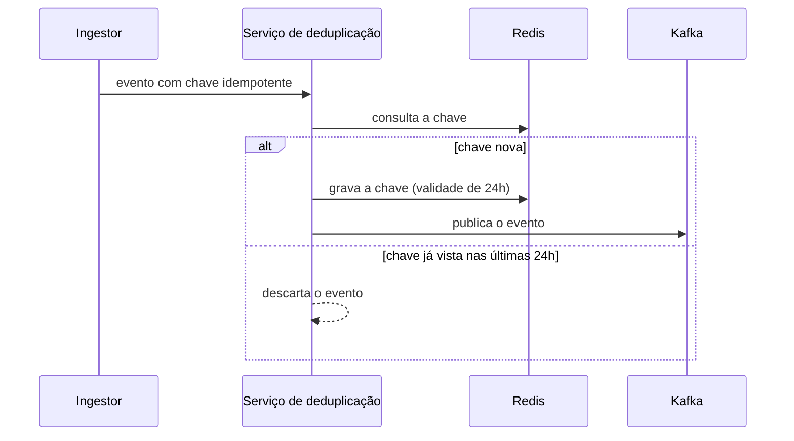

# Serviço de deduplicação de eventos · DD-2026-001

| | |
|---|---|
| **Documento** | DD-2026-001 |
| **Estado** | Rascunho |
| **Autores** | Rafael Nunes |
| **Revisores** | |
| **Criado em** | 2026-11-23 |
| **Última atualização** | 2026-11-23 |

## Motivação

Os produtores reenviam eventos quando fazem retry, e o pipeline de ingestão aceita esses reenvios como eventos novos. No mês passado medimos 4% de eventos duplicados. As duplicatas inflam os relatórios de faturamento, e o financeiro já reclamou duas vezes.

## Proposta

Vamos construir um serviço de deduplicação que fica entre o ingestor e o Kafka. Para cada evento, o serviço consulta a chave idempotente do evento no Redis. Se a chave não existe, o serviço grava a chave com validade de 24 horas e publica o evento no Kafka. Se a chave já existe, o serviço descarta o evento.

O ingestor entrega cada evento ao serviço de deduplicação em vez de publicá-lo direto no Kafka. O serviço usa o Redis como memória das chaves vistas nas últimas 24 horas e só repassa ao Kafka os eventos cuja chave ainda não estava lá. Os consumidores do Kafka continuam como estão e passam a receber o fluxo já deduplicado.

A forma da chave idempotente, a atomicidade entre consulta e gravação no Redis e o destino do evento descartado ainda estão em aberto (ver [Perguntas abertas](#perguntas-abertas), itens 1 a 3).

### Custo aceito

O serviço acrescenta um salto no caminho crítico da ingestão. Estimamos um aumento de 5 ms na latência de cada evento. O time aceitou esse custo em troca de resolver a duplicação num ponto só, antes do Kafka, sem exigir mudança nos consumidores.

## Alternativas consideradas

Esta seção não existe no template. Entrou aqui porque as alternativas descartadas explicam por que a proposta tem esta forma.

- **Não fazer nada.** As duplicatas continuam em torno de 4% e os relatórios de faturamento continuam inflados, o problema que o financeiro já apontou duas vezes.
- **Deduplicar no consumidor.** Descartada: cada consumidor do Kafka teria que reimplementar a deduplicação.
- **Usar a idempotência nativa do produtor Kafka.** Descartada: ela não cobre o reenvio que acontece entre reinícios do produtor.

## Riscos

O risco já identificado é o salto extra no caminho crítico, descrito em [Custo aceito](#custo-aceito). A janela de 24 horas define o alcance da deduplicação: o serviço só reconhece um reenvio que chega enquanto a chave do evento original ainda está no Redis.

Os demais riscos, e a mitigação de cada um, dependem de respostas do autor (ver [Perguntas abertas](#perguntas-abertas), itens 4 a 7), em especial o comportamento do serviço quando o Redis fica indisponível.

## Plano de rollout

O plano depende das respostas aos itens 8 e 9 de [Perguntas abertas](#perguntas-abertas): fases, critério de avanço e critério de rollback.

## Métricas de sucesso

- **Taxa de duplicatas abaixo de 0,1%**, contra os 4% medidos no mês passado.
- **Latência adicional da ingestão**, comparada com a estimativa de 5 ms. O limite aceitável ainda está em aberto (item 10).

## Perguntas abertas

1. O que compõe a chave idempotente de cada evento, e quem a gera: o produtor ou o ingestor? Todos os produtores já enviam essa chave?
2. A consulta e a gravação da chave no Redis acontecem numa operação atômica? Sem isso, dois reenvios simultâneos podem passar os dois.
3. O que acontece com o evento descartado: o serviço só o ignora, responde algo ao ingestor, registra em log ou contabiliza numa métrica?
4. Como o serviço se comporta quando o Redis fica indisponível ou lento: deixa passar os eventos sem deduplicar (mais duplicatas) ou bloqueia a ingestão (perda de disponibilidade)?
5. Por que 24 horas? Algum produtor pode reenviar depois desse prazo?
6. O serviço grava a chave antes ou depois de o Kafka confirmar a publicação? Se a publicação falhar depois da gravação, o reenvio legítimo seria descartado.
7. Qual o volume de eventos por segundo e quanto de memória o Redis precisa para guardar 24 horas de chaves? O Redis será dedicado ou compartilhado com outros sistemas?
8. Como o serviço entra em produção: por produtor, por percentual de tráfego, em modo sombra (só medindo, sem descartar)?
9. Qual o critério de avanço entre fases e o que dispara o rollback? Como voltamos o ingestor a publicar direto no Kafka?
10. Qual a latência adicional máxima aceitável, e em qual percentil medimos (média, p99)?
11. Como medimos os 4% do mês passado, e vamos usar o mesmo método para verificar a meta de 0,1%?
12. Os relatórios de faturamento já emitidos com duplicatas precisam de correção, ou o escopo cobre só eventos novos?
13. Quem deve revisar este documento (arquitetura, financeiro, donos dos produtores, time que opera o Redis)?
