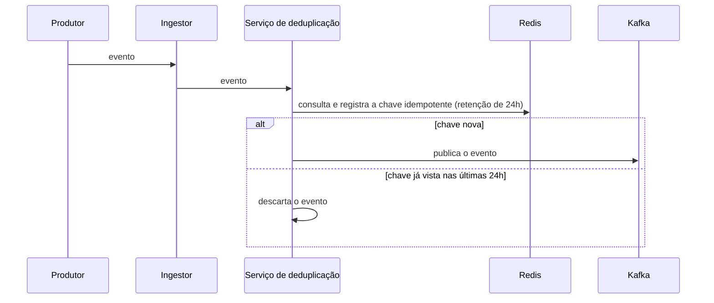

# Serviço de deduplicação de eventos · DD-2026-001

| | |
|---|---|
| **Documento** | DD-2026-001 |
| **Estado** | Rascunho |
| **Autores** | Rafael Nunes |
| **Revisores** | |
| **Criado em** | 2026-11-23 |
| **Última atualização** | 2026-11-23 |

## Motivação

O pipeline de ingestão recebe eventos duplicados dos produtores. A duplicata nasce no retry: quando um produtor reenvia um evento, o pipeline recebe as duas cópias e trata ambas como eventos distintos. No mês passado medimos 4% de duplicatas.

Essas duplicatas inflam os relatórios de faturamento. O time financeiro já reclamou duas vezes.

## Proposta

Vamos construir um serviço de deduplicação que fica entre o ingestor e o Kafka. Para cada evento, o serviço verifica a chave idempotente (o identificador que se repete quando o produtor reenvia o mesmo evento) no Redis. Se a chave ainda não foi vista, o serviço guarda a chave por 24 horas e publica o evento no Kafka. Se a chave já está lá, o serviço descarta o evento.

O produtor entrega o evento ao ingestor, como hoje. A mudança está no passo seguinte: o ingestor deixa de publicar direto no Kafka e passa a entregar o evento ao serviço de deduplicação. O serviço consulta o Redis pela chave idempotente do evento. Só o primeiro evento com uma dada chave chega ao Kafka; os reenvios que chegam dentro das 24 horas seguintes param no serviço.

### Trade-offs

- ✓ A deduplicação acontece em um único ponto, antes do Kafka. Nenhum consumidor precisa implementar a própria lógica.
- ✓ O serviço cobre reenvios que acontecem depois de um reinício do produtor, porque a memória das chaves fica no Redis e não no produtor.
- ✗ A ingestão ganha mais um salto no caminho crítico. Estimamos um acréscimo de 5 ms de latência e aceitamos esse custo.
- ✗ A proteção vale por 24 horas. Um reenvio que chegue depois que a chave expirou no Redis passa como evento novo (ver [Perguntas abertas](#perguntas-abertas)).

## Alternativas consideradas

| Alternativa | Por que perdeu |
|---|---|
| Não fazer nada | Os 4% de duplicatas continuam inflando os relatórios de faturamento, que já geraram duas reclamações do financeiro. |
| Deduplicar no consumidor | Cada consumidor teria que reimplementar a deduplicação. |
| Idempotência nativa do produtor Kafka | Não cobre o reenvio entre reinícios do produtor. |
| **Serviço de deduplicação entre o ingestor e o Kafka (escolhida)** | Resolve nos dois pontos em que as outras falham, ao custo de um salto a mais na ingestão (ver [Trade-offs](#trade-offs)). |

## Riscos

O risco já conhecido é o custo aceito nos trade-offs: o serviço entra no caminho crítico da ingestão e acrescenta latência, estimada em 5 ms. A janela de 24 horas também limita a proteção a reenvios que chegam dentro desse prazo.

A lista de riscos ainda não está completa, e nenhum dos riscos acima tem mitigação definida. Os pontos que faltam estão em [Perguntas abertas](#perguntas-abertas), em especial o comportamento da ingestão quando o serviço ou o Redis ficam indisponíveis.

## Plano de rollout

As fases, os critérios de avanço e o caminho de rollback ainda não foram definidos (ver [Perguntas abertas](#perguntas-abertas)).

## Métricas de sucesso

- Taxa de duplicatas abaixo de 0,1%, contra os 4% medidos no mês passado.

## Perguntas abertas

1. **Chave idempotente.** Todos os produtores já enviam uma chave idempotente em cada evento? Como ela é formada, e quem garante que um reenvio carrega a mesma chave?
2. **Janela de 24 horas.** Por que 24 horas? Existem reenvios que acontecem depois desse prazo e que, portanto, passariam pela deduplicação?
3. **Falha do serviço ou do Redis.** Se o serviço de deduplicação ou o Redis ficarem indisponíveis, a ingestão para ou os eventos seguem para o Kafka sem deduplicação? Qual é a mitigação para cada caso?
4. **Outros riscos.** Além da latência e da janela de 24 horas, que riscos o time já identificou (capacidade do Redis, falso positivo descartando um evento legítimo, perda de evento entre o registro da chave e a publicação no Kafka) e como cada um será mitigado?
5. **Latência.** De onde vem a estimativa de 5 ms? Existe um teto de latência acima do qual a proposta deixa de valer a pena?
6. **Rollout.** Como o serviço entra em produção: por produtor, por percentual de tráfego, em modo sombra (só medindo, sem descartar)? Qual é o critério para avançar de fase e como se faz o rollback?
7. **Medição.** Como os 4% foram medidos? A meta de 0,1% será acompanhada pelo mesmo método? Faz sentido acompanhar também a latência real da ingestão contra a estimativa de 5 ms?
8. **Revisores.** Quem revisa este documento? Sugestão: o time de arquitetura, o time responsável pelo Kafka e pelo Redis, e alguém do financeiro para validar a meta.
9. **Numeração.** Este é o primeiro documento em `docs/design/`, por isso recebeu o número DD-2026-001. Existe uma sequência mantida em outro lugar que este número deveria seguir?
