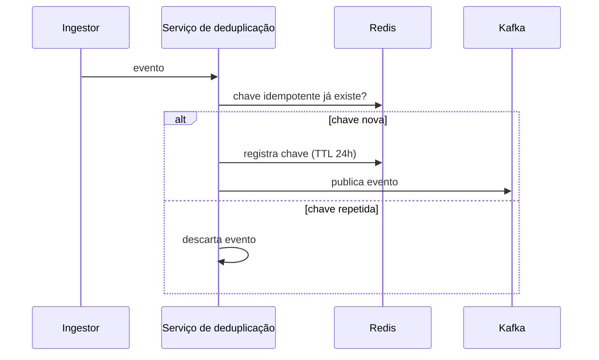

# Serviço de deduplicação de eventos · DD-2026-<seq>

| | |
|---|---|
| **Documento** | DD-2026-<seq> |
| **Estado** | Rascunho |
| **Autores** | Rafael Nunes |
| **Revisores** | |
| **Criado em** | 2026-11-23 |
| **Última atualização** | 2026-11-23 |

## Motivação

Os produtores reenviam eventos quando fazem retry, e o pipeline de ingestão hoje recebe essas duplicatas e as repassa adiante. No mês passado medimos 4% de eventos duplicados. As duplicatas inflam os relatórios de faturamento, e o financeiro já reclamou duas vezes.

## Proposta

Criamos um serviço de deduplicação que fica entre o ingestor e o Kafka. Para cada evento recebido, o serviço consulta no Redis a chave idempotente do evento. Se a chave não existe, o serviço a registra com validade de 24 horas e envia o evento ao Kafka. Se a chave já existe, o serviço descarta o evento.

O ingestor entrega cada evento ao serviço em vez de publicá-lo direto no Kafka. O serviço decide, com base na chave idempotente guardada no Redis, se o evento é novo ou repetido. Só eventos novos chegam ao Kafka. A janela de 24 horas limita o que o Redis guarda: um reenvio depois desse prazo passa a ser tratado como evento novo.

### Alternativas consideradas

Este template não tem seção para alternativas, então elas ficam aqui, dentro da Proposta.

- **Deduplicar no consumidor.** Descartada. Cada consumidor teria que reimplementar a deduplicação.
- **Idempotência nativa do produtor Kafka.** Descartada. Ela não cobre o reenvio entre reinícios do produtor, que é um dos cenários em que as duplicatas aparecem.
- **Não fazer nada.** Mantém os 4% de duplicatas e os relatórios de faturamento inflados, o que o financeiro já apontou como problema duas vezes.

### Trade-off aceito

O serviço é mais um salto no caminho crítico da ingestão. Estimamos +5ms de latência por evento. Aceitamos esse custo em troca de resolver a duplicidade num único ponto, antes do Kafka.

## Riscos

- **Latência.** O salto extra adiciona cerca de 5ms (estimativa, ainda não medida) a cada evento na ingestão.
- **Nova dependência no caminho crítico.** O serviço e o Redis passam a participar de toda ingestão. Como o pipeline se comporta quando um dos dois falha está em aberto (ver Perguntas abertas).
- **Janela de 24 horas.** Duplicatas reenviadas depois de 24 horas não são detectadas.

As mitigações de cada risco ainda não foram definidas.

## Plano de rollout

Ainda não definido. As fases, os critérios de avanço e os critérios de rollback dependem das respostas em Perguntas abertas.

## Métricas de sucesso

- Taxa de eventos duplicados abaixo de 0,1% (linha de base: 4% no mês passado).
- Latência adicional na ingestão próxima da estimativa de 5ms (valor a confirmar, ver Perguntas abertas).

## Perguntas abertas

1. Qual é o número sequencial deste documento (DD-2026-<seq>)? Não há outros documentos em `docs/design/` para continuar a numeração.
2. Quem são os revisores?
3. Como a chave idempotente é formada? Quem a gera (produtor ou ingestor) e todo evento já a carrega hoje?
4. O que o serviço faz quando o Redis está indisponível: deixa passar os eventos (risco de duplicatas) ou bloqueia a ingestão?
5. Como o serviço evita perder um evento se registrar a chave no Redis funcionar e a publicação no Kafka falhar?
6. O que o serviço responde ao ingestor quando descarta um duplicado? O produtor deve receber sucesso?
7. Qual é o volume de eventos por segundo e qual o tamanho estimado do Redis para 24h de chaves? O Redis terá alta disponibilidade?
8. Qual é o orçamento de latência da ingestão? Os +5ms são aceitáveis em p99 ou só na média?
9. Como mediremos a taxa de duplicatas depois do deploy (mesma forma dos 4%) e em que prazo se espera atingir 0,1%?
10. Como será o rollout (fases, critério de avanço, critério de rollback)?
11. Há duplicatas conhecidas que chegam depois de 24h? Se sim, a janela é suficiente?
12. Quais outras equipes são afetadas (produtores, consumidores, financeiro, infraestrutura do Redis)?
13. Qual é a mitigação planejada para cada risco listado acima?
