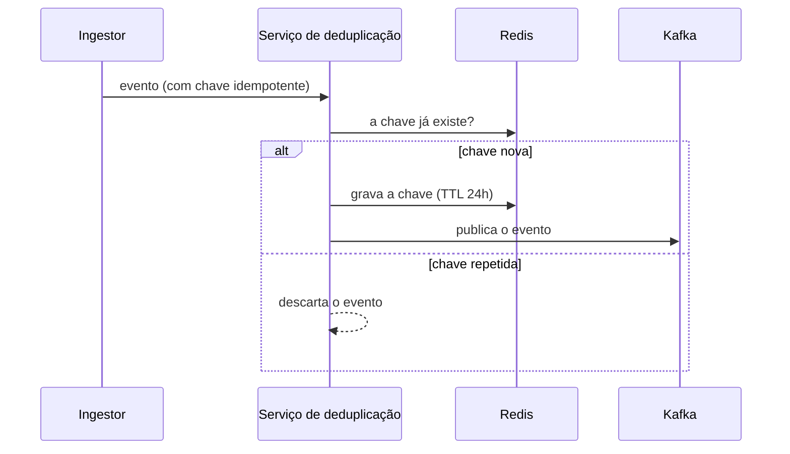

# Serviço de deduplicação de eventos · DD-2026-001

| | |
|---|---|
| **Documento** | DD-2026-001 |
| **Estado** | Rascunho |
| **Autores** | Rafael Nunes |
| **Revisores** | |
| **Criado em** | 2026-11-23 |
| **Última atualização** | 2026-11-23 |

## Motivação

O pipeline de ingestão recebe eventos duplicados dos produtores, que reenviam o mesmo evento quando fazem retry. No mês passado medimos 4% de eventos duplicados. As duplicatas inflam os relatórios de faturamento, e o financeiro já reclamou duas vezes.

## Proposta

Criamos um serviço de deduplicação que fica entre o ingestor e o Kafka. Cada evento carrega uma chave idempotente. O serviço consulta o Redis para saber se já viu essa chave. Se não viu, grava a chave com TTL de 24 horas e encaminha o evento ao Kafka. Se já viu, descarta o evento.

O ingestor envia cada evento ao serviço em vez de publicá-lo direto no Kafka. O serviço decide, com base apenas na chave idempotente, se o evento é novo. O Redis guarda as chaves vistas nas últimas 24 horas e expira as mais antigas sozinho. O Kafka só recebe eventos que o serviço aprovou, então os consumidores não precisam tratar duplicatas.

### Alternativas consideradas

Esta seção não existe no template. Incluímos porque o time discutiu alternativas e o motivo de descartá-las faz parte da decisão.

- **Deduplicar no consumidor.** Descartada. Cada consumidor teria que reimplementar a deduplicação.
- **Idempotência nativa do produtor Kafka.** Descartada. Ela não cobre o reenvio que acontece entre reinícios do produtor.
- **Não fazer nada.** Mantém os 4% de duplicatas e os relatórios de faturamento inflados.

### Trade-off aceito

O serviço adiciona um salto ao caminho crítico da ingestão. Estimamos +5 ms de latência por evento. Aceitamos esse custo em troca de deduplicar uma única vez, num único lugar, antes do Kafka.

## Riscos

- **Latência no caminho crítico.** O novo salto custa cerca de +5 ms (estimativa, ainda não medida). Mitigação: medir a latência real antes de avançar de fase (ver Plano de rollout).
- **Outros riscos de operação do serviço e do Redis.** Ainda não foram levantados. Ver Perguntas abertas.

## Plano de rollout

A definir. As fases, os critérios de avanço e de rollback não foram definidos. Ver Perguntas abertas.

## Métricas de sucesso

- Taxa de eventos duplicados abaixo de 0,1% (linha de base: 4% no mês passado).

## Perguntas abertas

1. **Falha do Redis.** O que o serviço faz quando o Redis está indisponível: deixa os eventos passarem (aceitando duplicatas) ou rejeita (aceitando perda de disponibilidade da ingestão)?
2. **Falha do próprio serviço.** Ele roda em quantas instâncias, e o que acontece com a ingestão se ele cair?
3. **Origem da chave idempotente.** Quem gera a chave: o produtor ou o ingestor? Todos os produtores já a enviam hoje?
4. **Janela de 24 horas.** Por que 24 horas? Um reenvio depois desse prazo passa a ser aceito como evento novo, e isso é aceitável para o faturamento?
5. **Atomicidade.** Se a gravação da chave no Redis acontece e a publicação no Kafka falha, o evento fica marcado como visto e se perde? Como tratamos esse caso?
6. **Rollout.** Quais as fases (por exemplo, por produtor ou por percentual), qual o critério para avançar e qual o gatilho de rollback?
7. **Latência.** Os +5 ms são um teto aceitável ou só uma estimativa? Qual o limite que bloqueia o avanço?
8. **Medição.** Como medimos a taxa de duplicatas depois do lançamento? Usamos o mesmo método dos 4% do mês passado?
9. **Capacidade do Redis.** Qual o volume de eventos por dia, e qual o dimensionamento e a topologia do Redis (cluster, réplicas, persistência)?
10. **Revisores e numeração.** Quem são os revisores do time de arquitetura? A sequência DD-2026-001 está correta? Não há outros documentos em `docs/design/`, então assumi o primeiro número do ano.
