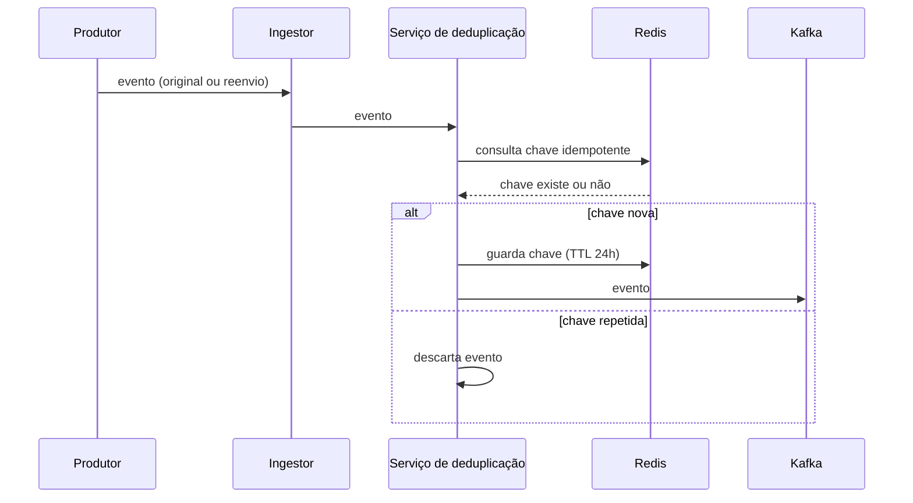

# Serviço de deduplicação de eventos · DD-2026-001

| | |
|---|---|
| **Documento** | DD-2026-001 |
| **Estado** | Rascunho |
| **Autores** | Rafael Nunes |
| **Revisores** | |
| **Criado em** | 2026-11-23 |
| **Última atualização** | 2026-11-23 |

## Motivação

O pipeline de ingestão recebe eventos duplicados dos produtores. A causa é o reenvio em retry: quando o produtor reenvia um evento, o pipeline o trata como um evento novo. No mês passado medimos 4% de eventos duplicados.

As duplicatas inflam os relatórios de faturamento. O financeiro já reclamou duas vezes.

## Proposta

Criar um serviço de deduplicação que fica entre o ingestor e o Kafka. Para cada evento recebido, o serviço consulta a chave idempotente do evento no Redis. Se a chave já existe, o serviço descarta o evento. Se não existe, o serviço guarda a chave no Redis por 24 horas e deixa o evento seguir para o Kafka.

O produtor envia o evento ao ingestor, que o repassa ao serviço de deduplicação. O serviço consulta o Redis. Quando a chave é nova, ele a registra com validade de 24 horas e encaminha o evento ao Kafka. Quando a chave já existe, ele descarta o evento e nada chega ao Kafka. A ordem exata entre registrar a chave e publicar no Kafka está em aberto (ver Perguntas abertas).

Como a deduplicação acontece antes do Kafka, todos os consumidores recebem o fluxo já sem duplicatas e nenhum precisa implementar a própria lógica.

### Alternativas consideradas

O template não prevê esta seção. Ela foi acrescentada entre Proposta e Riscos para registrar o raciocínio da decisão.

**Deduplicar no consumidor.** Descartada. Cada consumidor teria que reimplementar a deduplicação.

**Usar a idempotência nativa do produtor Kafka.** Descartada. Ela não cobre o reenvio entre reinícios do produtor.

## Riscos

**Mais um salto no caminho crítico da ingestão.** O serviço entra no caminho de todo evento. Estimamos +5ms de latência. O time aceita esse custo em troca de eliminar as duplicatas antes do Kafka. A estimativa ainda não foi medida.

Outros riscos, como a indisponibilidade do Redis ou do próprio serviço, não foram discutidos e estão em Perguntas abertas.

## Plano de rollout

Ainda não definido. As perguntas que faltam para escrevê-lo estão em Perguntas abertas.

## Métricas de sucesso

- Taxa de eventos duplicados abaixo de 0,1% (baseline medido no mês passado: 4%).

Outras métricas, como o limite aceitável de latência, estão em Perguntas abertas.

## Perguntas abertas

**Riscos**
1. O que acontece com a ingestão se o Redis ficar indisponível: os eventos passam sem deduplicação (fail-open) ou a ingestão para (fail-closed)?
2. O serviço de deduplicação é ponto único de falha? Quantas instâncias e como escala?
3. A chave só vive 24h. Reenvios que chegam depois dessa janela passam como novos. Os produtores reenviam dentro de 24h? Essa janela é suficiente para o faturamento?
4. Se o serviço grava a chave e a publicação no Kafka falha, o reenvio seguinte é descartado e o evento se perde. Qual é a ordem entre registrar a chave e publicar, e como tratamos essa falha?

**Proposta**
5. Quem define a chave idempotente: o produtor ou o ingestor? Todos os produtores já enviam uma?
6. Qual o volume de eventos por segundo, e qual o tamanho esperado do conjunto de chaves no Redis em 24h?
7. Quais protocolos ligam ingestor, serviço e Redis? (Deixei fora do diagrama por não terem sido informados.)

**Plano de rollout**
8. Como o serviço entra em produção: em fases, por produtor ou por percentual de tráfego? Qual critério avança cada fase e qual dispara o rollback?

**Métricas de sucesso**
9. Qual o limite aceitável de latência além dos +5ms estimados, e como mediremos a latência e a taxa de duplicatas em produção?

**Documento**
10. Quem revisa este documento (arquitetura, financeiro, donos dos produtores)? E qual é a sequência correta do ID, já que a pasta não tinha outros documentos? Usei DD-2026-001.
