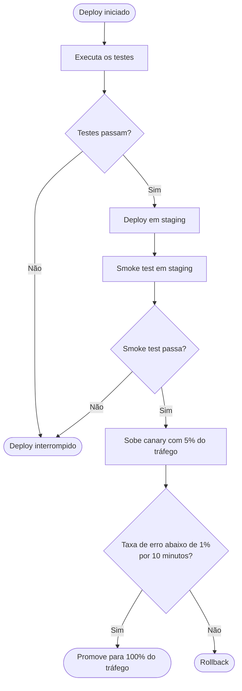

# Lógica de decisão do deploy

Pipeline de deploy: testes → staging → smoke test → canary (5%) → promoção ou rollback.

> Os ramos "Não" de *Testes passam?* e *Smoke test passa?* levam a **Deploy interrompido** por
> interpretação: a descrição original só define o rollback para a etapa do canary. Confirmar se
> uma falha no smoke test também exige rollback do staging.
