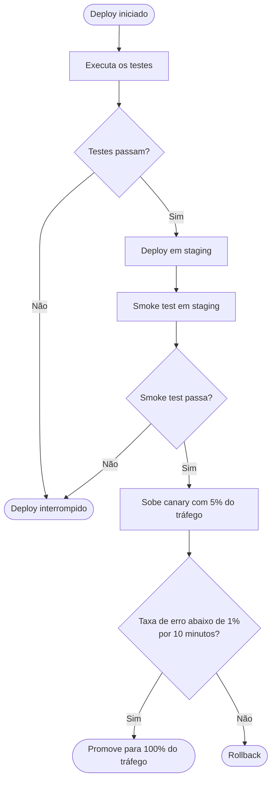

Um aviso antes do diagrama: a skill que você acionou é a de **diagramas de sequência** (interações entre componentes ao longo do tempo). O que você descreveu é uma lógica de decisão, e para isso o tipo certo é mesmo o `flowchart` — então fiz o flowchart, aplicando as mesmas regras da skill que fazem sentido aqui: só o que você descreveu entra no diagrama, e ele foi validado localmente antes da entrega.

**Validado com a imagem Docker do mermaid-cli** (`minlag/mermaid-cli`), renderizou sem erros. O bloco usa só sintaxe básica de flowchart, então renderiza direto no GitHub/GitLab. Também salvei em `deploy-flowchart.md` na raiz do repositório.

Leitura: testes → staging → smoke test → canary com 5% do tráfego → se a taxa de erro fica abaixo de 1% por 10 minutos, promove para 100%; senão, rollback.

**Uma escolha minha para você confirmar:** a sua descrição só define o rollback para a etapa do canary. Para os ramos "Não" de *Testes passam?* e *Smoke test passa?* desenhei um **Deploy interrompido** (nada foi para produção ainda), e deixei essa nota no arquivo. Se uma falha no smoke test também exige rollback do staging, me diga e eu aponto esse ramo para o `Rollback`.

Se em algum momento quiser mostrar *quem fala com quem* nesse pipeline (CI, orquestrador de deploy, serviço de métricas, gateway de tráfego) e em que ordem, aí sim um diagrama de sequência é o formato certo — é só pedir.
