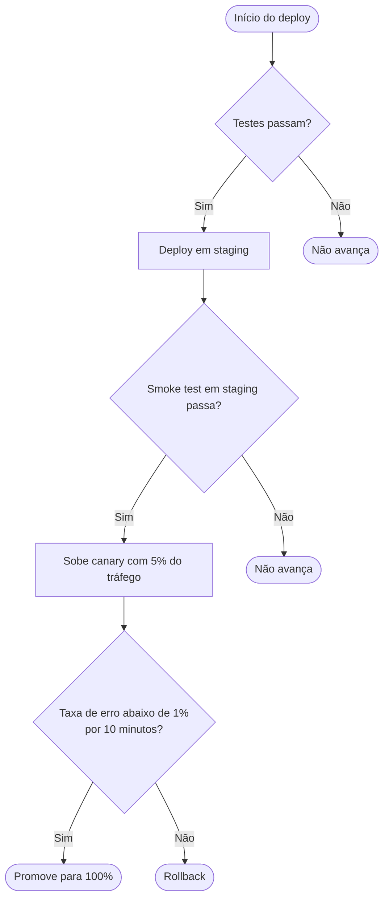

Aqui está o flowchart da lógica de decisão do deploy, exatamente como você descreveu:

Validado com a imagem Docker do mermaid-cli (renderizou sem erros). O bloco usa só sintaxe básica de `flowchart`, então renderiza direto no GitHub, GitLab e na maioria das wikis.

Leitura: três decisões em cadeia — testes → smoke test em staging → taxa de erro do canary — e cada "Sim" avança uma etapa; só o último "Não" (taxa de erro ≥ 1% na janela de 10 minutos) resulta em rollback, que foi o único caminho de falha que você descreveu.

Uma observação: para os dois primeiros "Não" (testes falham, smoke test falha) desenhei apenas "Não avança", porque você não disse o que acontece nesses casos. Se existe alguma ação aí (por exemplo, desfazer o deploy de staging, notificar alguém), me diz e eu ajusto os nós.

Nota: o que você pediu é um flowchart, não um diagrama de sequência — então este skill (mermaid-sequence) não se aplica ao conteúdo, mas aproveitei a mesma rotina de validação local. Se em algum momento quiser mostrar *quem* chama *quem* ao longo do tempo nesse pipeline (CI, orquestrador, serviço de métricas), aí sim um diagrama de sequência faz sentido.
