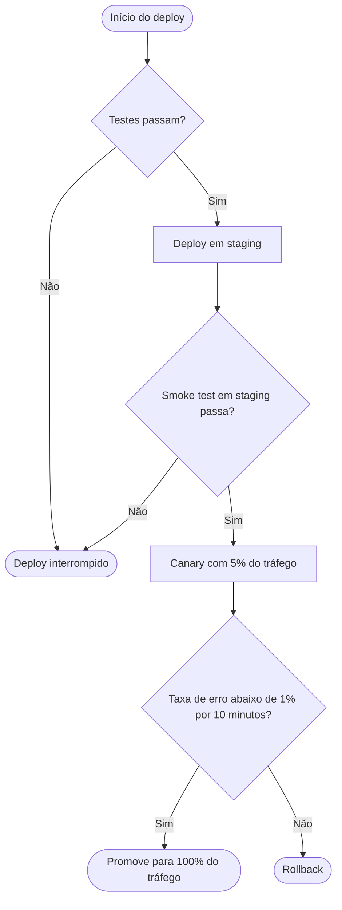

Aqui está o flowchart da lógica de decisão do deploy:

Validado com a imagem Docker do mermaid-cli (renderizou sem erros). O bloco renderiza direto em Markdown no GitHub/GitLab.

Lendo o fluxo: os testes decidem se o deploy chega a staging; o smoke test em staging decide se sobe o canary com 5% do tráfego; o canary é promovido para 100% só se a taxa de erro ficar abaixo de 1% por 10 minutos — caso contrário, rollback.

Um ponto que você não especificou e eu não quis inventar: o que acontece quando os **testes** ou o **smoke test** falham. Desenhei os dois ramos "Não" terminando em "Deploy interrompido" (não há nada em produção para reverter nessas etapas). Se na prática esses casos também disparam algum rollback, abrem um alerta ou seguem outro caminho, me diga e eu ajusto o diagrama.

Observação: este pedido era de um flowchart, não de um diagrama de sequência, então usei a sintaxe `flowchart` do Mermaid diretamente. Se em algum momento você quiser mostrar a troca de mensagens entre CI, orquestrador e monitoramento ao longo do tempo, aí sim um diagrama de sequência seria o formato adequado.
