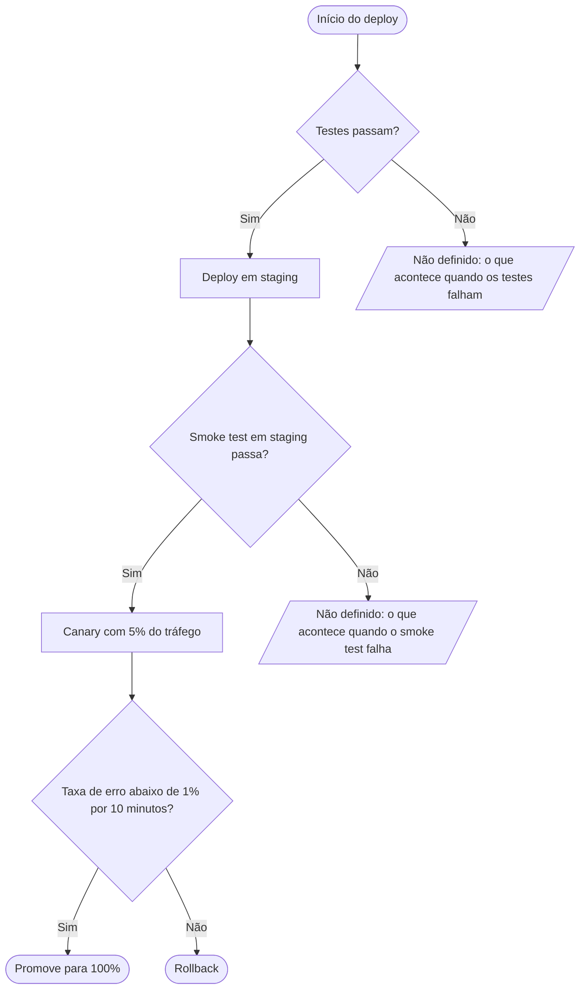

Uma observação antes: esta skill cobre diagramas de **sequência** em Mermaid (participantes trocando mensagens ao longo do tempo). O que você descreveu é lógica de decisão, então o encaixe certo é um `flowchart` — segue ele, no mesmo formato de bloco ```` ```mermaid ```` que renderiza direto no GitHub/GitLab.



Validado com a imagem Docker do mermaid-cli (`minlag/mermaid-cli`), que renderizou sem erro de parse.

Como ler: o fluxo passa por três decisões em cadeia — testes → staging, smoke test → canary com 5% do tráfego, taxa de erro abaixo de 1% por 10 minutos → promoção para 100%. O "senão, rollback" foi ligado à última decisão (taxa de erro), que é onde a frase se encaixa gramaticalmente.

Dois pontos ficaram em aberto e aparecem como nós marcados **"Não definido"** em vez de um desfecho inventado:

1. O que acontece quando os **testes falham** — o deploy simplesmente para, ou há notificação/outra ação?
2. O que acontece quando o **smoke test em staging falha** — também é rollback (de staging), ou só aborta?

Se me disser o comportamento real desses dois caminhos (e se o rollback do canary também se aplica a algum deles), eu substituo os nós marcados pelos desfechos corretos.
