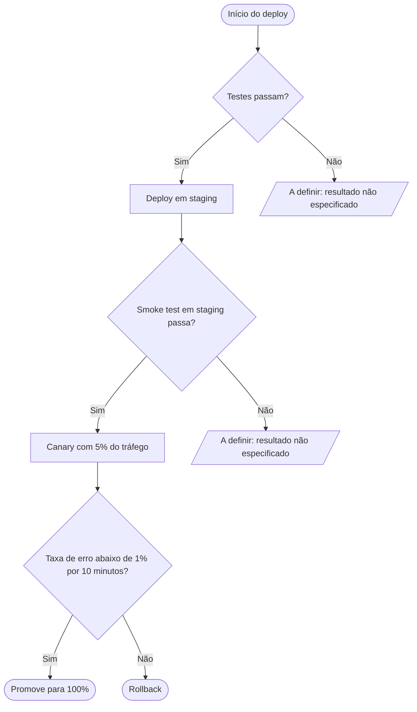

Uma observação de escopo antes: esta skill cobre diagramas de sequência Mermaid, e o que você descreveu é uma lógica de decisão com ramificações — isso é um `flowchart`. Entreguei como flowchart Mermaid puro, com as mesmas regras (só os passos e condições que você deu; nada inventado).

Validado com a imagem Docker do mermaid-cli (`minlag/mermaid-cli`), que renderizou sem erros de parse. O bloco usa só sintaxe básica de flowchart, então renderiza direto no GitHub, GitLab e na maioria das wikis.

Como ler: o fluxo começa nos testes; passando, faz o deploy em staging e roda o smoke test; passando, sobe o canary com 5% do tráfego; se a taxa de erro fica abaixo de 1% por 10 minutos, promove para 100%, senão faz rollback.

Dois pontos ficaram marcados como **"A definir"** em vez de receberem um desfecho inventado, porque o seu "senão, rollback" se liga apenas à condição da taxa de erro no canary:

1. **Testes falham** — o deploy simplesmente para? Notifica alguém? Ou também é um rollback?
2. **Smoke test em staging falha** — o mesmo: aborta, reverte o staging, ou outra coisa?

Me diga o que acontece nesses dois casos e eu troco os nós flagados pelos desfechos reais.
