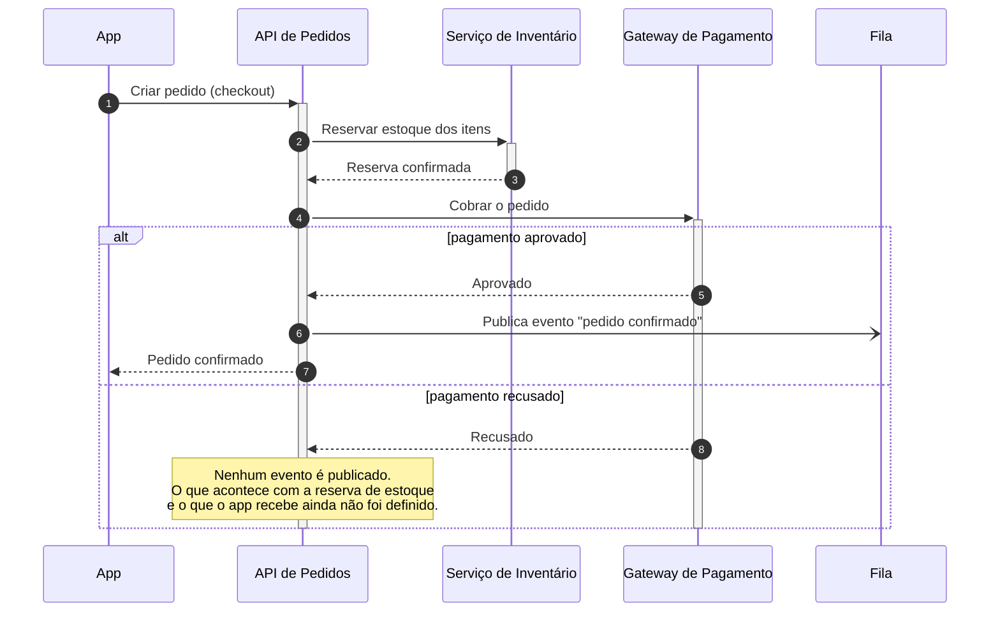

# Checkout — sequência de chamadas

Fluxo do checkout a partir da chamada do app à API de Pedidos: reserva de estoque, cobrança no gateway e publicação do evento de pedido confirmado. O ramo de pagamento recusado mostra apenas o que já foi estabelecido; as pendências estão listadas abaixo do diagrama.

## Pendências (ramo de pagamento recusado)

- A reserva de estoque é liberada? Por quem — a API de Pedidos chama o inventário, ou a reserva expira sozinha?
- O que o app recebe de volta: erro definitivo, ou o pedido fica pendente para tentar outro meio de pagamento?
- Algum evento é publicado na recusa (ex.: "pedido cancelado"), ou só no sucesso?
- Detalhes técnicos (endpoints, status HTTP, nome da fila/tópico, campos do evento) para as notas, se o diagrama deve carregá-los.

Validado com a imagem Docker do mermaid-cli (`minlag/mermaid-cli`).
