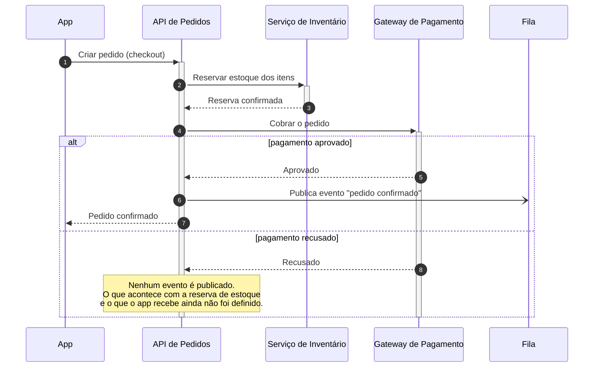

Esse pedido é um diagrama de sequência, não um diagrama C4: você quer a **ordem das chamadas** e o **desvio quando o pagamento é recusado**, e as views do Structurizr mostram estrutura estática (a *dynamic view* até enumera passos, mas não tem condicional — não há como expressar "se aprovado / se recusado"). Por isso não abri um `workspace.dsl`; desenhei o fluxo como diagrama de sequência Mermaid, que renderiza direto em Markdown (GitHub, GitLab, a maioria das wikis).

Salvei em `docs/checkout-sequencia.md` no repositório; o bloco está aqui também:

Lendo pelos números: o app abre o checkout na API de Pedidos (1); a API reserva o estoque no Serviço de Inventário (2–3) e manda a cobrança ao Gateway de Pagamento (4). Se aprovado (5), a API publica o evento "pedido confirmado" na fila (6, assíncrono) e responde ao app (7). Se recusado (8), nenhum evento é publicado — e é aí que o diagrama para, porque você disse que o pagamento pode ser recusado, mas não o que acontece em seguida, e caminho de falha não se inventa.

Para fechar o ramo de recusa, preciso de:

1. A reserva de estoque é liberada quando o pagamento é recusado? Quem libera — a API de Pedidos chama o inventário, ou a reserva expira sozinha?
2. O que o app recebe de volta: um erro definitivo, ou o pedido fica pendente para tentar outro meio de pagamento?
3. Algum evento é publicado na recusa (ex.: "pedido cancelado"), ou só no sucesso?
4. Quer os detalhes técnicos nas notas (endpoints, status HTTP, nome da fila/tópico, campos do evento) ou o diagrama fica conceitual? Se quiser, me passe os valores ou aponte o código.

O diagrama foi validado com a imagem Docker do mermaid-cli (parse OK). Se quiser também a visão **estrutural** desses mesmos elementos — app, API de Pedidos, inventário, gateway, fila e como se conectam — aí sim é um `workspace.dsl` (contexto + containers), e posso montar em seguida.
